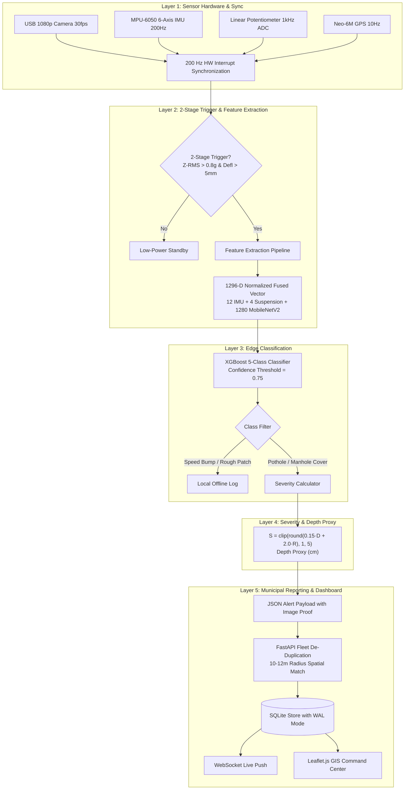

# RoadIQ - Municipal Command Center & Edge AI Framework

**Multi-Sensor Fusion Framework for Real-Time Pothole Detection, Classification, and Automated Municipal Reporting using Edge AI**  
*Lead Author & Inventor:* Budavarapu Dinesh, Lovely Professional University (LPU), Punjab.

---

## 🌟 Executive Summary

RoadIQ is a vehicle-mounted IoT edge system that autonomously detects road anomalies, classifies them into 5 distinct classes, computes an objective depth-proxy severity score (1 to 5), and dispatches structured JSON alerts with dashcam evidence to a municipal GIS command center without human intervention.

The edge unit executes entirely on a **Raspberry Pi 4 Model B (4 GB)** with zero cloud dependency during active driving.

### Headline Benchmark Results (Punjab Field Prototype, 3,200 Labelled Events, 12 km Corridor)
| Metric | Field Result | Benchmark vs Prior Art |
| :--- | :---: | :--- |
| **Overall 5-Class Accuracy** | **94.3%** | Accelerometer-only: 78.6% (+15.7% gain) |
| **Night / Simulated Rain Accuracy** | **89.7%** | Camera-only: 61.2% (+28.5% gain) |
| **False-Positive Rate (Day)** | **4.1%** | Accelerometer-only: 14.3% (**~71% relative reduction**) |
| **False-Positive Rate (Night/Rain)**| **5.8%** | Camera-only: 22.7% (**~74% relative reduction**) |
| **Edge Inference Latency (RPi 4)** | **87 ms** | XGBoost (2.3 MB) on 1296D concatenated vector |
| **End-to-End Trigger-to-Alert** | **142 ms mean** (198 ms max)| Within field reporting SLA |
| **Severity Score vs Physical Depth**| **$r = 0.87$** ($p < 0.001$)| Fitted by OLS across 120 measured potholes |

---

## 🏗️ System Architecture & 5 Layers



---

## 🧮 Mathematical Severity Formulation

Severity $S$ is derived from suspension dynamics:
$$S = \text{clip}\left(\text{round}(0.15 \cdot D + 2.0 \cdot R), 1, 5\right)$$

- $D$: Maximum suspension deflection in millimeters ($\text{mm}$)
- $R$: Onset rate of displacement ($\text{mm}/\text{ms}$)
- Depth proxy: $\text{Depth} \approx 0.22 \cdot D + 0.5 \cdot R \text{ cm}$

| Score ($S$) | Municipal Triage Level | Priority Flag | PWD Action Window | Color Code |
| :---: | :--- | :---: | :--- | :---: |
| **5** | **Critical** | **FLAGGED (Red)** | **Same-day emergency repair (< 24h)** | `#EF4444` |
| **4** | **High** | **FLAGGED (Red)** | **Priority dispatch (< 48h)** | `#F97316` |
| **3** | **Medium** | Normal (Amber) | Amber alert, repair within 72h | `#F59E0B` |
| **2** | **Low** | Normal (Green) | Schedule repair within 7 days | `#10B981` |
| **1** | **Minor** | Normal (Green) | Routine road maintenance cycle | `#14B8A6` |

---

## 🚀 Quickstart & Local Execution

### 1. Requirements & Dependencies
- Python 3.9+
- FastAPI, Uvicorn, Pydantic, WebSockets

```bash
cd /Users/dinesh1121/Projects/RoadIQ
pip install -r requirements.txt
```

### 2. Run the Municipal Command Center
```bash
python3 -m uvicorn server:app --host 127.0.0.1 --port 8000 --reload
```
Open **[http://127.0.0.1:8000](http://127.0.0.1:8000)** in any modern browser.

---

## 🛰️ REST API Specification

### Ingest Alert from Edge Vehicle
```bash
curl -X POST http://127.0.0.1:8000/api/alerts \
  -H "Content-Type: application/json" \
  -d '{
    "latitude": 31.2505,
    "longitude": 75.7112,
    "vehicle_id": "PB-08-BUS-402",
    "vehicle_speed": 46.5,
    "anomaly_class": "Pothole",
    "ward_id": "Ward 4 - GT Road NH-44",
    "road_name": "NH-44 Chaheru Flyover Northbound",
    "sensor_snapshot": {
      "imu_z_rms": 1.78,
      "gyro_x_peak": 26.4,
      "peak_frequency": 14.8,
      "kurtosis": 6.2,
      "suspension_deflection_d": 22.4,
      "suspension_onset_rate_r": 1.75,
      "visual_confidence": 0.96
    }
  }'
```

### Trigger Edge Simulator
```bash
curl -X POST http://127.0.0.1:8000/api/simulator/trigger
```

### Export PWD Municipal Work Orders (CSV)
```bash
curl -O http://127.0.0.1:8000/api/export/csv
```

### Fetch GIS GeoJSON FeatureCollection
```bash
curl -s http://127.0.0.1:8000/api/alerts/geojson
```

### Fetch Ward Road Health & SLA Compliance Analytics
```bash
curl -s http://127.0.0.1:8000/api/analytics/wards
```

### Filter Alerts by SLA Status (`breached`, `at_risk`, `on_track`, `met`)
```bash
curl -s "http://127.0.0.1:8000/api/alerts?sla_status=breached"
```

---

## 📊 Ward Analytics & SLA Compliance Tracker
RoadIQ tracks municipal repair accountability against severity-tiered PWD SLA windows (**24h** for S-5 Critical, **48h** for S-4 High, **72h** for S-3 Medium, **7d** for S-2 Low, **14d** for S-1 Minor):
- **Live SLA Countdowns & Overdue Filtering**: Every alert exposes `sla_hours`, `sla_deadline`, `sla_remaining_minutes`, `sla_elapsed_pct`, and `sla_status` (`on_track`, `at_risk`, `breached`, `met`), surfaced directly on triage cards, work order modals, and CSV exports.
- **Per-Ward Road Health Score (0–100)**: `GET /api/analytics/wards` computes a weighted health index and operational grade (`Good`, `Fair`, `Poor`, `Critical`) per municipal ward, sorted worst-first in the interactive Ward Analytics drawer with one-click map focusing and an SLA Escalation Watchlist.

---

## 🛡️ Fleet De-Duplication Engine
When multiple fleet vehicles (e.g., Punjab Roadways buses, police patrol units, delivery trucks) drive over the same road anomaly:
1. The backend evaluates great-circle spatial distance using the **Haversine formula** ($R = 6371 \text{ km}$).
2. If another active alert exists within **$12 \text{ meters}$**:
   - The system suppresses duplicate ticket creation.
   - The `confirmation_count` increments.
   - The reporting vehicle ID is appended to the audit trail.
   - If $\text{confirmation\_count} \ge 3$, the ticket automatically receives the **Multi-Vehicle High-Confidence Shield (🛡️)**, raising municipal repair priority.
