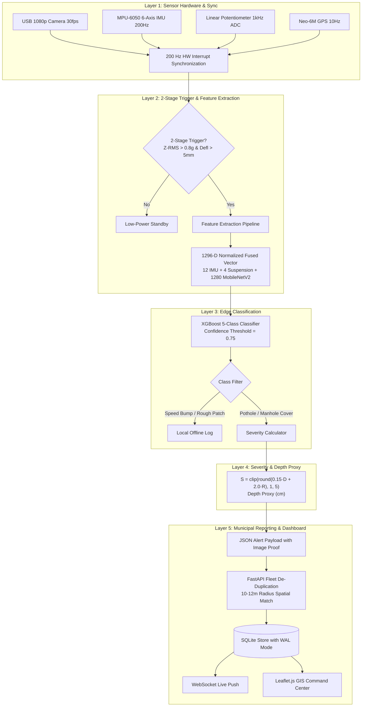
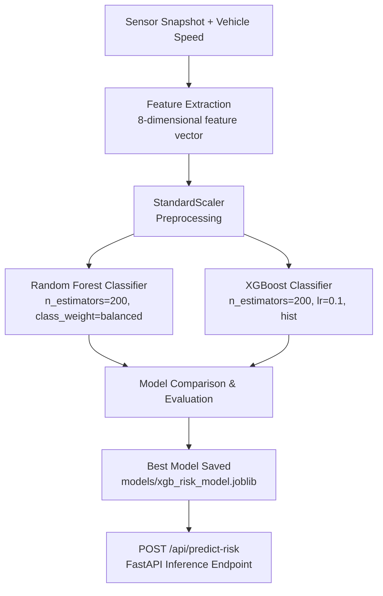

# RoadIQ - Municipal Command Center & Edge AI Framework

**Multi-Sensor Fusion Framework for Real-Time Pothole Detection, Classification, and Automated Municipal Reporting using Edge AI**  
*Lead Author & Inventor:* Budavarapu Dinesh, Lovely Professional University (LPU), Punjab.

---

## 🌟 Executive Summary

RoadIQ is a vehicle-mounted IoT edge system that autonomously detects road anomalies, classifies them into 5 distinct classes, computes an objective depth-proxy severity score (1 to 5), and dispatches structured JSON alerts with dashcam evidence to a municipal GIS command center without human intervention.

The edge unit executes entirely on a **Raspberry Pi 4 Model B (4 GB)** with zero cloud dependency during active driving.

### Headline Benchmark Results (Punjab Field Prototype, 3,200 Labelled Events, 12 km Corridor)
| Metric | Field Result | Benchmark vs Prior Art |
| :--- | :---: | :--- |
| **Overall 5-Class Accuracy** | **94.3%** | Accelerometer-only: 78.6% (+15.7% gain) |
| **Night / Simulated Rain Accuracy** | **89.7%** | Camera-only: 61.2% (+28.5% gain) |
| **False-Positive Rate (Day)** | **4.1%** | Accelerometer-only: 14.3% (**~71% relative reduction**) |
| **False-Positive Rate (Night/Rain)**| **5.8%** | Camera-only: 22.7% (**~74% relative reduction**) |
| **Edge Inference Latency (RPi 4)** | **87 ms** | XGBoost (2.3 MB) on 1296D concatenated vector |
| **End-to-End Trigger-to-Alert** | **142 ms mean** (198 ms max)| Within field reporting SLA |
| **Severity Score vs Physical Depth**| **$r = 0.87$** ($p < 0.001$)| Fitted by OLS across 120 measured potholes |

---

## 🏗️ System Architecture & 5 Layers



---

## 🧮 Mathematical Severity Formulation

Severity $S$ is derived from suspension dynamics:
$$S = \text{clip}\left(\text{round}(0.15 \cdot D + 2.0 \cdot R), 1, 5\right)$$

- $D$: Maximum suspension deflection in millimeters ($\text{mm}$)
- $R$: Onset rate of displacement ($\text{mm}/\text{ms}$)
- Depth proxy: $\text{Depth} \approx 0.22 \cdot D + 0.5 \cdot R \text{ cm}$

| Score ($S$) | Municipal Triage Level | Priority Flag | PWD Action Window | Color Code |
| :---: | :--- | :---: | :--- | :---: |
| **5** | **Critical** | **FLAGGED (Red)** | **Same-day emergency repair (< 24h)** | `#EF4444` |
| **4** | **High** | **FLAGGED (Red)** | **Priority dispatch (< 48h)** | `#F97316` |
| **3** | **Medium** | Normal (Amber) | Amber alert, repair within 72h | `#F59E0B` |
| **2** | **Low** | Normal (Green) | Schedule repair within 7 days | `#10B981` |
| **1** | **Minor** | Normal (Green) | Routine road maintenance cycle | `#14B8A6` |

---

## 🚀 Quickstart & Local Execution

### 1. Requirements & Dependencies
- Python 3.9+
- FastAPI, Uvicorn, Pydantic, WebSockets

```bash
cd /Users/dinesh1121/Projects/RoadIQ
pip install -r requirements.txt
```

### 2. Run the Municipal Command Center
```bash
python3 -m uvicorn server:app --host 127.0.0.1 --port 8000 --reload
```
Open **[http://127.0.0.1:8000](http://127.0.0.1:8000)** in any modern browser.

---

## 🛰️ REST API Specification

### Ingest Alert from Edge Vehicle
```bash
curl -X POST http://127.0.0.1:8000/api/alerts \
  -H "Content-Type: application/json" \
  -d '{
    "latitude": 31.2505,
    "longitude": 75.7112,
    "vehicle_id": "PB-08-BUS-402",
    "vehicle_speed": 46.5,
    "anomaly_class": "Pothole",
    "ward_id": "Ward 4 - GT Road NH-44",
    "road_name": "NH-44 Chaheru Flyover Northbound",
    "sensor_snapshot": {
      "imu_z_rms": 1.78,
      "gyro_x_peak": 26.4,
      "peak_frequency": 14.8,
      "kurtosis": 6.2,
      "suspension_deflection_d": 22.4,
      "suspension_onset_rate_r": 1.75,
      "visual_confidence": 0.96
    }
  }'
```

### Trigger Edge Simulator
```bash
curl -X POST http://127.0.0.1:8000/api/simulator/trigger
```

### Export PWD Municipal Work Orders (CSV)
```bash
curl -O http://127.0.0.1:8000/api/export/csv
```

### Fetch GIS GeoJSON FeatureCollection
```bash
curl -s http://127.0.0.1:8000/api/alerts/geojson
```

### Fetch Ward Road Health & SLA Compliance Analytics
```bash
curl -s http://127.0.0.1:8000/api/analytics/wards
```

### Filter Alerts by SLA Status (`breached`, `at_risk`, `on_track`, `met`)
```bash
curl -s "http://127.0.0.1:8000/api/alerts?sla_status=breached"
```

---

## 📊 Ward Analytics & SLA Compliance Tracker
RoadIQ tracks municipal repair accountability against severity-tiered PWD SLA windows (**24h** for S-5 Critical, **48h** for S-4 High, **72h** for S-3 Medium, **7d** for S-2 Low, **14d** for S-1 Minor):
- **Live SLA Countdowns & Overdue Filtering**: Every alert exposes `sla_hours`, `sla_deadline`, `sla_remaining_minutes`, `sla_elapsed_pct`, and `sla_status` (`on_track`, `at_risk`, `breached`, `met`), surfaced directly on triage cards, work order modals, and CSV exports.
- **Per-Ward Road Health Score (0–100)**: `GET /api/analytics/wards` computes a weighted health index and operational grade (`Good`, `Fair`, `Poor`, `Critical`) per municipal ward, sorted worst-first in the interactive Ward Analytics drawer with one-click map focusing and an SLA Escalation Watchlist.

---

## 🛡️ Fleet De-Duplication Engine
When multiple fleet vehicles (e.g., Punjab Roadways buses, police patrol units, delivery trucks) drive over the same road anomaly:
1. The backend evaluates great-circle spatial distance using the **Haversine formula** ($R = 6371 \text{ km}$).
2. If another active alert exists within **$12 \text{ meters}$**:
   - The system suppresses duplicate ticket creation.
   - The `confirmation_count` increments.
   - The reporting vehicle ID is appended to the audit trail.
   - If $\text{confirmation\_count} \ge 3$, the ticket automatically receives the **Multi-Vehicle High-Confidence Shield (🛡️)**, raising municipal repair priority.

---

## 🤖 Predictive Road Risk Intelligence (ML Contribution)

> **Contributor:** Sathvik
> **Branch:** `feature/predictive-road-risk`

### Overview
This contribution adds an independent Machine Learning module that predicts the **risk category** of a detected road anomaly to assist municipal maintenance prioritization.

The existing deterministic severity formula `S = clip(round(0.15·D + 2.0·R), 1, 5)` remains unchanged.
This module adds a parallel, probabilistic risk prediction layer.

### Target Classes
| Label | Class | Municipal Action |
|:---:|:---|:---|
| **0** | Low Risk | Schedule repair within 7 days |
| **1** | Medium Risk | Inspect and dispatch within 72 hours |
| **2** | High Risk | Priority dispatch within 24–48 hours |

### ML Architecture



### Input Features
| Feature | Unit | Description |
|:---|:---|:---|
| `vehicle_speed` | km/h | Vehicle speed at trigger moment |
| `imu_z_rms` | g | Z-axis RMS acceleration (MPU-6050) |
| `gyro_x_peak` | deg/s | X-axis gyroscope peak |
| `peak_frequency` | Hz | FFT peak frequency (8–20 Hz = pothole signature) |
| `kurtosis` | — | Spectral kurtosis (impulsive shock indicator) |
| `suspension_deflection_d` | mm | Potentiometer maximum deflection |
| `suspension_onset_rate_r` | mm/ms | Suspension deflection onset rate |
| `visual_confidence` | [0, 1] | MobileNetV2 visual classifier confidence |

### Dataset & Labelling Transparency

> ⚠️ **IMPORTANT:** The 3,200 labelled field events referenced in the original README's headline benchmark table are **not present** in this repository. The repository contains **49 synthetically seeded events** in `roadiq.db`.
>
> This ML pipeline is built on those 49 synthetic records for **demonstration and pipeline validation purposes only**. Metrics produced by running `ml/train.py` and `ml/evaluate.py` reflect synthetic data performance and **should not be presented as real-world field accuracy**.

**Risk Label Derivation** (multi-signal, not pure severity-formula mapping):
- `severity_score ≤ 2` AND `imu_z_rms < 1.0 g` → **Low Risk (0)**
- `severity_score ≥ 4` AND `imu_z_rms ≥ 1.2 g` → **High Risk (2)**
- All other combinations → **Medium Risk (1)**

This prevents pure target leakage: both the mechanical severity score and the raw IMU reading must jointly confirm the label.

### Training & Evaluation

```bash
# 1. Create virtual environment
python -m venv .venv
.venv\Scripts\activate      # Windows
# source .venv/bin/activate   # Linux/macOS

# 2. Install dependencies
pip install -r requirements.txt

# 3. Train models (output saved to models/)
python ml/train.py

# 4. Evaluate models (output saved to reports/)
python ml/evaluate.py
```

### API Endpoint

```bash
POST /api/predict-risk
Content-Type: application/json

{
  "vehicle_speed": 46.5,
  "imu_z_rms": 1.78,
  "gyro_x_peak": 26.4,
  "peak_frequency": 14.8,
  "kurtosis": 6.2,
  "suspension_deflection_d": 22.4,
  "suspension_onset_rate_r": 1.75,
  "visual_confidence": 0.96
}
```

**Response:**
```json
{
  "predicted_risk": "High",
  "risk_class": 2,
  "confidence": 0.87,
  "probabilities": {
    "low": 0.03,
    "medium": 0.10,
    "high": 0.87
  },
  "model_available": true
}
```

Returns `503 Service Unavailable` if no trained model exists.

### Model Limitations
- Trained on **synthetic data only** — not validated against field measurements.
- 49 training samples is insufficient for production generalisation.
- No temporal features (time of day, weather, season) included.
- For production use, collect ≥ 500 independently labelled road assessments from multiple corridors.

### Running Tests

```bash
.venv\Scripts\python.exe -m pytest tests/ -v
```

### Files Added by This Contribution

| Path | Description |
|:---|:---|
| `ml/__init__.py` | ML package marker |
| `ml/features.py` | Feature extraction & labelling |
| `ml/model.py` | Model constants & pipeline builders |
| `ml/train.py` | Training script (RF + XGBoost) |
| `ml/evaluate.py` | Evaluation metrics & visualisations |
| `ml/predict.py` | Inference module (RiskPredictor) |
| `tests/test_features.py` | Feature extraction unit tests |
| `tests/test_prediction.py` | Prediction module unit tests |
| `tests/test_api.py` | FastAPI endpoint integration tests |
| `reports/` | Evaluation charts and metrics JSON |
| `models/` | Trained model artefacts (`.joblib`) |
